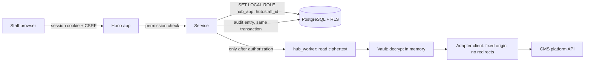

# Website Management Hub: architecture

Status: development foundation. **Not deployed.** Nothing here has connected to a live customer site, a hosted database or StackLTR. See [remaining-requirements.md](remaining-requirements.md) for what stands between this and production.

## What it is

An internal CrumByte staff tool for managing customer websites on WordPress, Shopify, Wix, Squarespace, Joomla and other CMS platforms. It records what is managed, who is responsible, what work was done, and what has actually been measured. StackLTR stays the CRM: the hub holds references to customers, tickets and billing, never copies.

## Decisions

| Decision | Choice | Why |
| --- | --- | --- |
| Where it lives | Self-contained `hub/` package in `crumbytes/website` | Keeps PR #2's hub work together, with no effect on the public site. `.vercelignore` keeps `hub/` out of the public deployment. |
| Hosting | A **separate** Vercel project with root directory `hub/`, on its own hostname | The public site serves every repo file as a static asset: `https://crumbyte.com/infra/remote-support/schema.sql` returned 200 on 2026-11-01. An internal app must not share that deployment or origin. |
| Runtime | Node 24, [Hono](https://hono.dev), plain ES modules, no build step | Matches the repo's plain JavaScript and `node:test`. A small route surface is easy to review. |
| Interface | Server-rendered HTML forms with **no client JavaScript** | Client credentials cannot reach browser code if there is no browser code. Allows a CSP of `default-src 'none'`. |
| Staff sign-in | OpenID Connect with PKCE against an identity provider | The hub stores no staff passwords, and MFA is enforced at the provider. The provider is the owner's choice. |
| Sessions | Random token in a `__Host-` cookie, stored as a SHA-256 hash | 30-minute idle and 8-hour absolute limits, server-side revocation. Role changes and disabling apply on the next request. |
| Database | PostgreSQL, in schema `hub`, with row level security | Same engine family as StackLTR. Forward-only migrations in `db/migrations`, currently **proposals**. |
| Credentials | AES-256-GCM envelope encryption with the key outside the database | See [security.md](security.md). |
| Integrations | One adapter module per platform, through one guarded HTTP client | See [cms-capabilities.md](cms-capabilities.md). |
| StackLTR | References plus an outbox, off by default | See [stackltr-integration.md](stackltr-integration.md). |

The prototype page `website-management.html` from PR #2 is unchanged. The hub carries over its design, but the prototype is still a static page on the public site and should be removed before PR #2 merges (see the remaining requirements).

## Structure

```
hub/
  api/index.js          Vercel entry. Serves 503 when configuration is missing or unsafe.
  db/migrations/        Schema and access control proposals.
  src/app.js            Routes, sign-in gate, CSRF, security headers, error handling.
  src/auth.js           OIDC flow and sessions.
  src/authz.js          Permission table.
  src/services/         Business rules. Every function takes the signed-in staff context.
  src/adapters/         Platform modules and their shared framework.
  src/vault.js          Credential encryption.
  src/safe-http.js      The only route to staff-supplied addresses.
  src/stackltr.js       Outbox delivery.
  src/ui/               Server-rendered pages. Values are escaped by default.
  scripts/dev.mjs       Local server with in-process PostgreSQL and a sign-in stub.
  tests/                Automated tests, on real PostgreSQL through PGlite.
```

## Request flow



Each request is checked twice: once by permission in the service, then again by row level security in the database. Either alone would stop a technician reading another client's data, and tests cover both separately.

## Data model

Migration: [0001_foundation.sql](../db/migrations/0001_foundation.sql). Access rules: [0002_access_control.sql](../db/migrations/0002_access_control.sql).

| Area | Tables | Notes |
| --- | --- | --- |
| Identity | `staff_users`, `staff_sessions`, `oidc_login_states` | Provisioned in advance. No passwords. |
| Clients | `client_accounts`, `staff_client_assignments`, `service_plans` | A client is a name and StackLTR references, with no contact details. |
| Websites | `managed_websites` | URL, CMS, hosting provider, plan, lifecycle. |
| Platforms | `platform_connections`, `connection_credentials`, `platform_snapshots`, `operation_requests` | Credentials are in their own table, with different grants. |
| Maintenance | `maintenance_schedules`, `maintenance_tasks`, `service_history` | History is append-only. |
| Monitoring | `monitoring_checks`, `monitoring_results`, `security_reviews` | Results are append-only, and no row means unknown. |
| Backups | `backup_sources`, `backup_runs`, `restore_verifications` | Restore evidence is append-only and constrained. |
| Integration | `stackltr_outbox` | Events wait here if StackLTR is unavailable. |
| Audit | `audit_log` | Append-only hash chain. |

Child tables carry `client_account_id` and use composite foreign keys to their website, so the database refuses a row that names a website belonging to another client.

## Honest status rules

These are product rules, enforced in code and covered by tests:

- **Unknown is a real state.** A check that has never run shows as unknown, never as healthy. With probes turned off, no result row is written.
- **A failed check is not a site claim.** A rejected credential or an outage is recorded with a safe error code against the connection. It says nothing about whether the site is healthy.
- **A successful backup does not prove recovery.** Only a passed restore of a successful backup, with an evidence reference and less than 90 days old, shows as verified. Anything else says so plainly. This is decided in one function, `recoverabilityOf`.
- **No sample data.** A new installation has no clients, plans, results or reviews. Empty pages say that nothing has been recorded and that this is not a clean result.
- **Adapters are labelled unverified** until each has been run against a real authorized site.

## Scheduling

`POST /internal/jobs/run` with a bearer secret runs due monitoring checks and StackLTR delivery. It does nothing unless `HUB_OUTBOUND_ENABLED` is on. Picking a scheduler is an open decision, because Vercel Hobby cron is limited to daily runs, which is too coarse for uptime checks. Reminders are computed from the records and shown on the Overview page. **No reminder emails are sent yet.**
