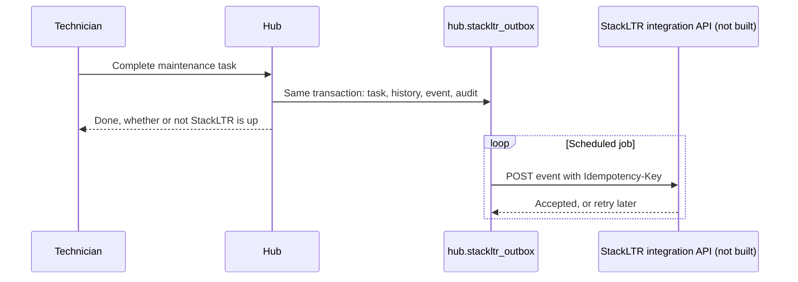

# StackLTR integration design

Status: **design, with the hub side built and tested against a stand-in. Nothing connects to StackLTR.** The API the hub would call does not exist yet and has to be built and reviewed in the StackLTR repository. No StackLTR file, database or deployment was changed or contacted for this work. The StackLTR repository was read for reference only, at its checkout on 2026-11-01. Its table names may change while its release is in progress.

## Rule

StackLTR owns customers, contacts, tickets and billing. The hub owns websites, platform connections, monitoring, backups and restore evidence. The hub stores **references only**, and a test confirms it has no tables or columns for contacts, invoices or tickets.

## Record mapping

| Hub concept | Hub field | StackLTR record | Direction |
| --- | --- | --- | --- |
| Client account | `stackltr_workspace_id`, `stackltr_company_id` | `workspaces`, `crm_companies` | Hub stores the reference |
| Customer contacts | None | `crm_contacts` | Read in StackLTR, never copied |
| Support ticket | `maintenance_tasks.stackltr_request_id` | `crm_service_requests` | Hub stores the reference |
| Completed maintenance | `stackltr_outbox` event `maintenance.completed` | `crm_record_events`, on the linked request | Hub sends a summary |
| Service history | `service_history`, the full technical record | Summary only in StackLTR | Hub sends a summary |
| Billing | `stackltr_billing_ref` on client and plan | Invoices in `crm_invoice_ledger` | Opaque reference, no amounts |
| Staff roles | Same names as `workspace_memberships.role` | Separate accounts for now | See open decisions |

## Boundary



- **The hub never touches StackLTR's database.** It only uses an API that StackLTR authorizes and audits itself, so StackLTR's row level security and RPC rules stay authoritative. A shared database or a service-role key is explicitly rejected.
- **A StackLTR outage never blocks website work.** Events wait in the outbox.
- **Delivery is at least once, so it must be idempotent.** Each event has a stable `idempotency_key`, such as `maintenance.completed:<task id>`.
- **Unlinked clients hold their events** until an admin links them. Rejected credentials or permissions stop retrying and need a person. Outages retry up to 8 times, then stop as failed.
- **Off by default** (`HUB_STACKLTR_ENABLED`).

## API the hub expects (to be built in StackLTR)

All calls would be server to server, scoped to one workspace, with a dedicated integration credential, not a user session or service-role key.

```
POST /api/integrations/website-hub/v1/events
Authorization: Bearer <integration credential>
Idempotency-Key: maintenance.completed:<task id>

{
  "type": "maintenance.completed",
  "idempotency_key": "maintenance.completed:<task id>",
  "workspace_id": "<uuid>",
  "company_id": "<uuid>",
  "data": { "task_id": "<uuid>", "website_id": "<uuid>", "title": "…", "stackltr_request_id": "<uuid or null>" }
}
```

Later, read-only lookups so staff can pick a company or request instead of pasting an ID:

```
GET /api/integrations/website-hub/v1/companies?query=
GET /api/integrations/website-hub/v1/requests?company_id=
```

StackLTR must verify that the company and request belong to the workspace on the credential, and write an event through its existing RPC rules. Customer-visible messages must follow StackLTR's rule of keeping infrastructure details out, so the event sends a title rather than technical detail.

## Linking today

Without the API, an admin can paste the StackLTR workspace and company IDs on the client form. The hub cannot verify them, so a link only records what was typed. The lookup endpoints replace this.

## Open decisions for the owner and StackLTR's release owner

1. **Staff identity.** Sharing StackLTR's Supabase Auth as the OIDC provider would give one sign-in, but ties the hub's availability to it. A separate workforce provider such as Google Workspace or Microsoft Entra is the alternative. Recommendation: a workforce provider, since this is staff-only and StackLTR Auth is also customer-facing.
2. **Timing.** StackLTR is mid-release, so the integration API should wait until that release settles.
3. **Which StackLTR workspace.** The hub assumes CrumByte's own workspace holds these customers.
4. **Customer visibility.** Whether a customer ever sees maintenance summaries in StackLTR's portal. Nothing is exposed now.
